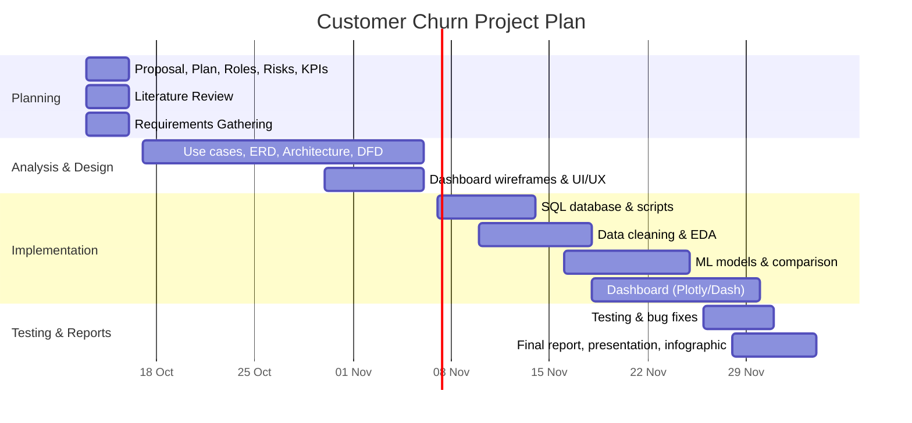

# Project Planning & Management

## Project Proposal

### Project Title
Customer Churn Intelligence & Retention System

### Overview
A subscription-based company is losing customers but does not know which customers are most likely to leave, or which customer characteristics are associated with churn. This project builds a data-driven system that identifies churn patterns and predicts customers at higher risk of leaving.

### Problem Statement
The business lacks visibility into:
- Which customer segments and subscription types churn the most.
- Which customer attributes (services, contract type, billing, tenure) are associated with churn.
- Which current customers are at high risk and should be targeted for retention.

### Objectives
1. Build a relational database from the Telco dataset (split the single CSV into tables such as customers, services, contracts/billing) and query it with SQL.
2. Clean the data (missing and inconsistent values) and perform EDA.
3. Analyze the relationship between customer characteristics and churn.
4. Build and compare multiple classification models (Logistic Regression, KNN, Decision Tree, SVM).
5. Produce customer-level churn predictions and a high-risk customer list.
6. Deliver an interactive Plotly/Dash dashboard.
7. Explain findings to a hypothetical business stakeholder.

### Dataset
**Telco Customer Churn** (Kaggle, IBM sample data): https://www.kaggle.com/datasets/blastchar/telco-customer-churn
- One CSV file, about 7,043 customers and 21 columns (demographics, services, contract, billing, `Churn` target).
- Churn is roughly 26% of customers (imbalanced).
- `TotalCharges` has a few blank values to clean.
- No date column: time analysis is done through `tenure` (months with the company), not calendar time.
- No separate transactions or support tables: the relational schema is derived from the single CSV.

### Scope
**In scope**
- SQL scripts and relational database
- Dataset and data dictionary
- Jupyter analysis notebook
- ML pipeline and model comparison
- Interactive dashboard (churn rate, churn by segment, churn by subscription type, churn trends, high-risk list)
- Final business report and README
- GitHub repository

**Out of scope (optional extension only if time permits)**
- MLflow experiment tracking / model registry
- FastAPI prediction service

### Expected Deliverables
GitHub repository containing: business problem definition, SQL scripts, dataset/data dictionary, Jupyter notebook, ML pipeline, model comparison, interactive dashboard, final business report, README.

### Team
_Fill in team members and instructor (see `task-assignment-roles.md`)._

---

## Project Plan

### Timeline (Official DEPI Deadlines)
| Phase | Deadline |
|---|---|
| Project Planning & Management | 16 Oct 2026 |
| Literature Review | 16 Oct 2026 |
| Requirements Gathering | 16 Oct 2026 |
| System Analysis & Design | 6 Nov 2026 |
| Implementation (Source Code & Execution) | 30 Nov 2026 |
| Final Presentation, Testing & Reports | 4 Dec 2026 |

### Gantt Chart

### Milestones
| # | Milestone | Date |
|---|---|---|
| M1 | Planning, literature review, requirements submitted on GitHub | 16 Oct 2026 |
| M2 | Design documents complete (ERD, use cases, architecture, UI) | 6 Nov 2026 |
| M3 | Code, models, dashboard complete | 30 Nov 2026 |
| M4 | Testing, reports, presentation, infographic delivered | 4 Dec 2026 |

### Deliverables per Milestone
- **M1:** proposal, plan, roles, risks, KPIs, literature review, stakeholder analysis, user stories, requirements.
- **M2:** problem statement, use case diagram, software architecture, ERD, logical/physical schema, DFD, sequence/activity/state/class diagrams, wireframes, tech stack.
- **M3:** SQL scripts, dataset and data dictionary, notebook, ML pipeline, model comparison, dashboard, README.
- **M4:** test plan and cases, bug reports, user manual, technical documentation, presentation (PPT/PDF), infographic, final business report.

### Resource Allocation
| Resource | Use |
|---|---|
| Team members (4 to 6) | See `task-assignment-roles.md` |
| GitHub | Version control, all documents and code |
| Python (Pandas, scikit-learn, Plotly/Dash), Jupyter | Analysis, ML, dashboard |
| SQL database | Telco customer, services, contract and billing tables |

_Adjust sub-dates to your team's actual capacity._

---

## Task Assignment & Roles

> Per the project instructions, the team must send the work division to the instructor within 4 weeks of the project booklet announcement.

| Member | Role | Responsibilities |
|---|---|---|
| _Member 1_ | Team Lead / Project Manager | Plan, Gantt, coordination with instructor, GitHub repo management, final report |
| _Member 2_ | Data Engineer (SQL) | Database design, SQL scripts, dataset and data dictionary |
| _Member 3_ | Data Analyst | Data cleaning, EDA, churn pattern analysis, business insights |
| _Member 4_ | ML Engineer | Classification models (Logistic Regression, KNN, Decision Tree, SVM), model comparison, predictions |
| _Member 5_ | Dashboard Developer | Plotly/Dash dashboard (churn rate, segments, subscription types, trends, high-risk list) |
| _Member 6_ | QA & Documentation | Test plan, test cases, bug reports, user manual, presentation, infographic |

_If the team has 4 members, merge roles (for example Data Engineer + Data Analyst, and Dashboard + QA)._

### Cross-cutting responsibilities
- Everyone commits to GitHub with meaningful commit messages.
- Everyone can explain their own part during the final presentation (individual contribution is evaluated).
- Weekly individual assessment by the instructor: each member delivers interim outputs on time.

---

## Risk Assessment & Mitigation Plan

| # | Risk | Likelihood | Impact | Mitigation |
|---|---|---|---|---|
| 1 | Dataset is a single flat CSV with no transactions, support, or date data | High | Medium | Derive relational tables from the CSV; use tenure cohorts instead of time trends; agree with the instructor that this satisfies the SQL/database requirement |
| 2 | Missing or inconsistent values (blank `TotalCharges`, text-typed numbers, "No internet service" categories) | High | Medium | Define cleaning rules; document imputation choices; validate after cleaning |
| 3 | Class imbalance (roughly 26% churn) | High | High | Use stratified split, class weights or resampling; evaluate with Recall, F1, ROC-AUC rather than Accuracy only |
| 4 | Overfitting or data leakage | Medium | High | Train/test split before preprocessing fit; cross-validation; remove target-leaking features |
| 5 | Team member unavailable or tasks delayed | Medium | High | Weekly check-ins; shared task board; backup owner for each task |
| 6 | Merge conflicts or lost work on GitHub | Medium | Medium | Branching strategy (feature branches + pull requests); frequent small commits |
| 7 | Dashboard performance or deployment problems | Low | Medium | Keep data aggregated; test locally first; fall back to screenshots/video demo |
| 8 | Scope creep (MLflow, FastAPI) | Medium | Medium | Treat extensions as optional; only start after core deliverables are done |
| 9 | Unclear requirements from instructor | Low | Medium | Confirm deliverable expectations with instructor early |
| 10 | Privacy of customer data | Low | Medium | Use anonymized or public data; do not use data outside the initiative |

---

## Key Performance Indicators (KPIs)

### Business KPIs (what the system reports)
| KPI | Definition |
|---|---|
| Churn rate | Churned customers / total customers in the period |
| Churn by segment | Churn rate per customer segment |
| Churn by subscription type | Churn rate per plan |
| Churn trend | Churn rate by tenure cohort (no calendar dates in the dataset) |
| High-risk customers | Count and list of customers above the prediction threshold |

### Model KPIs
| KPI | Target (to be refined after EDA) |
|---|---|
| Recall (churn class) | Prioritized: catching churners matters most |
| Precision (churn class) | Reasonable, to avoid wasting retention budget |
| F1-score | Primary comparison metric across models |
| ROC-AUC | Overall ranking quality |
| Models compared | At least 4 (Logistic Regression, KNN, Decision Tree, SVM) |

### Project KPIs
| KPI | Target |
|---|---|
| Deliverables submitted on time | 100% of DEPI deadlines |
| Dashboard load/response time | Responsive for interactive filtering (e.g. under a few seconds) |
| System uptime (demo) | Dashboard runs without errors during final presentation |
| Documentation completeness | All required documents present on GitHub |
| User adoption rate | Share of target stakeholders (e.g. marketing/retention team) who use the dashboard, measured during the demo or pilot |
| Team participation | Every member has commits and an explained responsibility |

_Numeric targets for model metrics should be set after the first baseline results._

---

